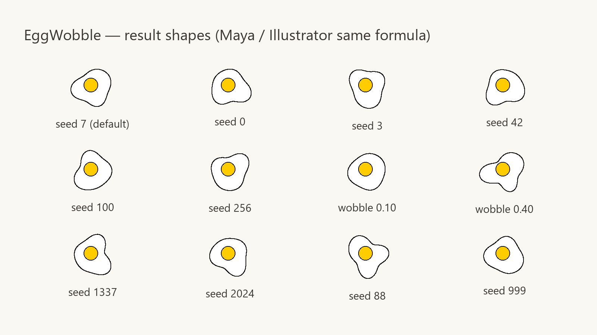
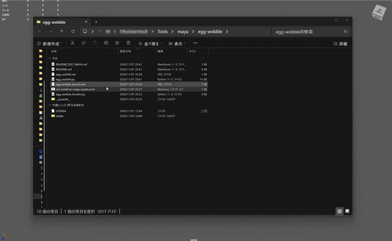
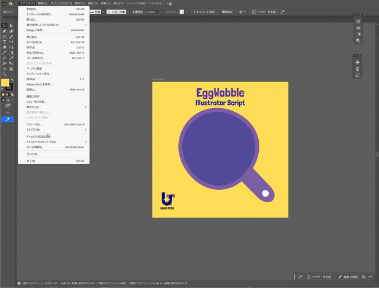
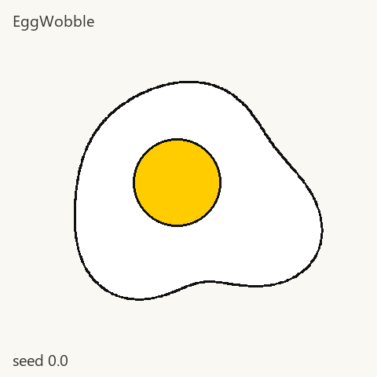

# EggWobble

**Unagi Tech Inc.（株式会社うなぎテック）** · MIT License

[](https://ko-fi.com/unagitech)

Soft, low-frequency “fried egg” outline — a wobbling egg white plus an offset yolk. Same polar formula for **Maya** and **Adobe Illustrator**.



| Build | Version | Folder |
|-------|---------|--------|
| Maya | 1.2.1 | [`maya/`](maya/) |
| Illustrator | 1.2.0 | [`illustrator/`](illustrator/) |

## Demos

### Maya



### Illustrator



Seed morph (shape variation by seed):



## Quick start

**Maya**

1. Run `maya/run-install-to-maya-scripts.cmd` (or copy `egg_wobble.py` + `egg_wobble_launch.mel` into `Documents\maya\scripts\`)
2. Script Editor → Python:

```python
import importlib
import egg_wobble as ew
importlib.reload(ew)
ew.show()
```

Details: [maya/README.md](maya/README.md)

**Illustrator**

1. Open a document
2. **File → Scripts → Other Script…** → `illustrator/egg_wobble.jsx`

Details: [illustrator/README.md](illustrator/README.md)

## License

[MIT](LICENSE) — Copyright (c) 2026 Unagi Tech Inc.

Keep the copyright / credit when you modify or redistribute.

使ってくれたら [X @UnagiTech](https://x.com/UnagiTech) をフォロー／作品にタグ付けしてくれると嬉しいです（お願いであり、商用の条件ではありません）。

## Support

Tips are optional (Ko-fi). They help us keep shipping and maintaining free tools.

[](https://ko-fi.com/unagitech)

## Links

- Lab org: [UnagiTechLab](https://github.com/UnagiTechLab)
- Company: [unagi.tech](https://www.unagi.tech)
- Support / tip: [Ko-fi](https://ko-fi.com/unagitech) · [BOOTH](https://unagitech.booth.pm/)
